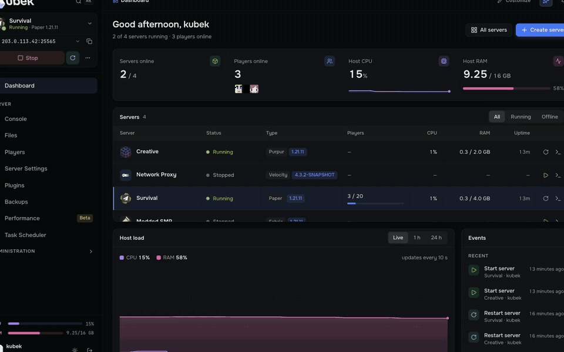

<div align="center">


**Панель управления Minecraft-серверами**

Все ваши серверы в одном веб-интерфейсе: создавайте их, правьте конфиги, следите за состоянием, ставьте плагины и моды, работайте с файлами и бэкапами, следите за логами



[](https://hub.docker.com/r/seeroy/kubek-minecraft-dashboard)
[](https://hub.docker.com/r/seeroy/kubek-minecraft-dashboard)
[](https://github.com/Seeroy/kubek-minecraft-dashboard/releases)
[](https://github.com/Seeroy/kubek-minecraft-dashboard/stargazers)

[English](README.md) · **Русский**

[Возможности](#-возможности) · [ИИ-ассистент](#-ии-ассистент) · [Роли и доступ](#-роли-и-уровни-доступа-rbac) · [Расширения](#-расширения-и-blueprintы-для-разработчиков) · [Быстрый старт](#-быстрый-старт) · [Миграция](#-миграция-с-предыдущей-версии-1x---3x) · [Настройка](#-настройка) · [Сборка из исходников](#-сборка-из-исходников) · [Документация API ↗](https://rest.wiki/?https://raw.githubusercontent.com/Seeroy/kubek-minecraft-dashboard/refs/heads/main/openapi.json)

</div>

---

## ✨ Возможности

### Серверы

- Запускайте сколько угодно серверов параллельно: Vanilla, Paper, Purpur, Folia, Spigot, Fabric, NeoForge, Forge, Quilt, Bedrock, прокси Velocity и Waterfall или свой jar
- Типы серверов сгруппированы по играм, новые игры добавляются blueprint`ами
- Запуск, остановка, перезапуск и ввод команд в консоль, вывод отображается в реальном времени через WebSocket
- Сервер можно продублировать, выгрузить в один файл или, наоборот, импортировать. Серверы раскладываются по папкам, а лишние удаляются пачкой
- Новый сервер создаётся через короткий wizard, а подходящая версия Java скачивается сама — не нужно искать нужный JRE вручную
- Модпаки ставятся прямо из Modrinth или из файла `.mrpack`, вместе со всеми модами
- Сети Velocity: прокси и его серверы настраиваются вместе, включая секрет форвардинга
- Каждый сервер работает как процесс на хосте или в своём Docker-контейнере, выбор делается один раз при создании
- Параметры запуска в одном месте: память, флаги Aikar (для Velocity и Waterfall свой набор), вывод консоли в UTF-8 и вся строка JVM, если хочется поправить её руками

### Плагины и моды

- Поиск и установка плагинов (Bukkit/Spigot/Paper) и Fabric-модов из Modrinth
- Если что-то устарело, обновление — в один клик
- Зависимости подтягиваются автоматически, а дерево зависимостей показывает, что откуда пришло
- Нужного jar нет на Modrinth? Загрузите его сами

### Мониторинг и диагностика

- CPU, RAM и онлайн по каждому серверу в реальном времени, плюс ресурсы самого хоста (CPU, память, диски)
- Графики истории CPU/RAM — можно посмотреть, что было, а не только текущий момент
- Список игроков с никами, аватарами и статусом онлайн — читается по протоколу самой игры (Java Query, Bedrock, Valve A2S и другие через gamedig)
- Общий список всех игроков со всех серверов, с карточкой игрока и быстрыми действиями
- Необязательный плагин **Kubek Companion** (Paper, Spigot, Purpur, Folia) добавляет TPS, источники лагов, пинг игроков и их активность. Игроки его не заметят
- Анализ логов ловит типовые проблемы — нехватку памяти, занятый порт, повреждённый мир, краши плагинов и модов, не ту версию Java — а панель диагностики там, где может, предлагает решение

### Файлы, консоль и бэкапы

- Файловый менеджер с редактором Monaco (тот самый, что в VS Code), загрузкой перетаскиванием и работой с архивами
- Real-time консоль с вводом команд, умными подсказками + отдельный интерфейс для просмотра старых логов
- Создание и восстановление бэкапов: отдельного мира или сервера целиком
- Политики хранения для каждого сервера или общие для панели, с копиями в S3-совместимое хранилище. Закреплённые бэкапы не удаляются

### Автоматизация

- **Планировщик** — задачи по cron, по простому интервалу или однократно в заданное время. Действие — это запуск/остановка/перезапуск, команда в консоль, бэкап или исходящий вебхук. Есть превью cron-расписания и история запусков по каждой задаче, чтобы видеть, что реально сработало
- **Telegram-бот** — уведомления и удалённое управление: вход по OTP, кнопки управления серверами и даже мастер создания сервера, на русском или английском
- **Центр уведомлений** — краши, низкий TPS, неудачные бэкапы, завершённые задачи, новые входы и новые версии панели приходят во входящие панели, а любую категорию можно продублировать в Telegram

### Доступ и права

- Несколько аккаунтов с правами по каждой функции (см. [Роли и доступ](#-роли-и-уровни-доступа-rbac) ниже) и опциональным доступом к конкретным серверам
- Двухфакторка — приложение TOTP или подтверждение нажатием в Telegram — и список активных сессий, каждую из которых можно отозвать
- Журнал аудита: кто что сделал, с поиском, фильтрами и выгрузкой
- API-ключи для своих скриптов и встроенный MCP-сервер, чтобы ИИ-агенты работали с панелью в рамках тех же прав

### Под себя

- Дашборд, который можно собрать как удобно: виджеты с серверами, ресурсами хоста, диагностикой и бэкапами перетаскиваются мышкой
- Командная палитра позволяет быстро переключаться между вкладками с клавиатуры
- Цветовые темы, редактор своей темы и режим стримера, который прячет личные данные на экране
- Типы серверов описываются **blueprint`ами**, а **система расширений** панели умеет добавлять новые функции, UI, обработчики событий и собственные права. И то и другое ставится в пару кликов из каталога на GitHub
- Встроенный FTP-сервер
- Полная локализация на русский и английский

---

## 🤖 ИИ-ассистент

Чат прямо в панели, который знает ваши серверы. Он сам читает консоли, логи, конфиги и метрики, а всё, что меняет сервер, сначала ждёт вашего подтверждения

- Работает с OpenAI, Gemini, DeepSeek, Mistral, Groq, OpenRouter, локальными Ollama и LM Studio или любым OpenAI-совместимым API
- Составляет план для многошаговых задач, переспрашивает, если что-то неясно, принимает скриншоты и файлы и умеет искать в интернете
- Спросить про проблему можно прямо из панели диагностики или строки консоли, а можно написать ему в Telegram-боте
- Доступ к нему выдаётся как любое другое право: просмотр, чтобы пользоваться, управление, чтобы настраивать провайдеров и ключи

---

## 🔐 Роли и уровни доступа (RBAC)

Доступ разбит на разделы, и в каждом до трёх уровней: **просмотр**, **изменение** и **управление**. Старший уровень включает младшие. Аккаунт получает доступ через роли, отдельные права сверху или и то и другое

| Раздел           | Уровни                             | Что охватывает                                     |
| ---------------- | ---------------------------------- | -------------------------------------------------- |
| Консоль          | просмотр, изменение                | Консоль и полный лог, отправка команд              |
| Питание          | просмотр, изменение, управление    | Статус, запуск / остановка / перезапуск, kill      |
| Настройки        | просмотр, изменение, управление    | Настройки, `server.properties`, ядро, удаление     |
| Файлы            | просмотр, изменение, управление    | Файловый менеджер, логи сервера и FTP              |
| Плагины и моды   | просмотр, изменение, управление    | Установленное, каталог, установка, удаление        |
| Игроки           | просмотр, изменение, управление    | Вайтлист, кик, операторы и баны                    |
| Бэкапы           | просмотр, изменение, управление    | Скачивание, создание, восстановление и удаление    |
| Планировщик      | просмотр, изменение, управление    | Задачи и их запуски                                |
| Серверы          | изменение, управление              | Создание, импорт, дублирование, модпаки, папки     |
| Сети             | просмотр, изменение, управление    | Сети Velocity                                      |
| Аккаунты         | просмотр, изменение, управление    | Аккаунты и роли                                    |
| Журнал аудита    | просмотр, управление               | Журнал и его ротация                               |
| Мониторинг       | просмотр                           | CPU / RAM / диски хоста                            |
| Java             | просмотр, изменение, управление    | Установленные версии, установка, удаление, своя Java |
| Хранилища        | просмотр, управление               | Хранилища бэкапов и их ключи                       |
| Интеграции       | управление                         | Telegram-бот, расширения и blueprint`ы             |
| ИИ-ассистент     | просмотр, управление               | Работа с ассистентом, провайдеры и ключи           |
| Панель           | управление                         | Общие настройки, подсети, секреты, обновления      |

Готовые роли: **Viewer**, **Moderator**, **Operator** и **Server admin**. Можно завести свои, опасные права помечены в редакторе

Сверх того, аккаунт без прав администратора можно **ограничить конкретными серверами**. Первые восемь разделов тогда действуют только на эти серверы, а управлять такой аккаунт может только аккаунтами в пределах тех же серверов

Расширения могут заводить свои права, они появляются в редакторе рядом со встроенными

---

## 🧩 Расширения и blueprint`ы (для разработчиков)

Kubek рассчитан на расширение извне, без форка. **Blueprint`ы** описывают типы серверов — как сервер скачивается (напрямую, через установщик вроде Forge или через SteamCMD для игр из Steam), настраивается, запускается и опрашивается, — а **расширения** добавляют целые функции: новые страницы и UI, маршруты API, обработчики событий и собственные права

Два SDK со стартовыми шаблонами помогут начать за пару минут:

| SDK                                                                            | npm                                                                                | Стартовый шаблон                                                          |
| ------------------------------------------------------------------------------ | ---------------------------------------------------------------------------------- | ------------------------------------------------------------------------- |
| **Extension SDK** — функции, UI, маршруты API, события и права                  | [`@kubekpanel/extension-sdk`](https://www.npmjs.com/package/@kubekpanel/extension-sdk) | [KubekPanel/extension-template](https://github.com/KubekPanel/extension-template) |
| **Blueprint SDK** — описание новых типов серверов (скачивание, конфиг, запуск)  | [`@kubekpanel/blueprint-sdk`](https://www.npmjs.com/package/@kubekpanel/blueprint-sdk) | [KubekPanel/blueprint-template](https://github.com/KubekPanel/blueprint-template) |

---

## 🚀 Быстрый старт

### Установка одной командой (Linux / macOS)

```bash
curl -fsSL https://raw.githubusercontent.com/Seeroy/kubek-minecraft-dashboard/main/install.sh | bash
```

Скрипт определит систему и сам либо скачает нативный бинарник, либо развернёт Docker. Затем откройте **http://localhost:8000**. Если при первом запуске этот порт занят, Kubek возьмёт следующий свободный (до 8010) и запомнит его

<details>
<summary>Параметры скрипта установки</summary>

```bash
# Принудительно через Docker Compose
curl -fsSL .../install.sh | bash -s -- --docker

# Принудительно нативный бинарник (ошибка, если платформа не поддерживается)
curl -fsSL .../install.sh | bash -s -- --binary

# Своя папка / версия / установка без запуска
curl -fsSL .../install.sh | bash -s -- --dir /opt/kubek --version v4.1.2 --no-run
```

</details>

### Docker (готовый образ)

```bash
docker run -d --name kubek -p 8000:8000 -v kubek-data:/data seeroy/kubek-minecraft-dashboard:latest
```

### Готовый бинарник

Скачайте бинарник под свою ОС со [страницы релизов](https://github.com/Seeroy/kubek-minecraft-dashboard/releases) и запустите:

```bash
chmod +x Kubek-*-linux-x64
./Kubek-*-linux-x64
```

---

## 🔄 Миграция с предыдущей версии (1.x - 3.x)

Переходите со старой версии Kubek? Миграция **автоматическая** — Kubek сам импортирует старые данные при первом запуске, отдельный инструмент не нужен

1. Положите файлы старой установки в рабочую папку Kubek (`/data` в Docker):
   - `config.json` — настройки панели (язык, FTP, Telegram-бот, порт веб-сервера…)
   - `users.json` — аккаунты и их права
   - `servers/` — папку целиком, вместе с `servers/servers.json` и файлами серверов
2. Запустите Kubek и **следите за выводом в консоли**

Что произойдёт:

- ⚙️ **Настройки** перенесутся в новую базу
- 🎮 **Серверы** импортируются, а их папки переименуются в новый формат `servers/<uuid>`. Jar-файл ядра и флаги JVM (`-Xmx`/`-Xms`) определяются из старых стартовых скриптов автоматически
- 👥 **Аккаунты** переносятся вместе с правами, но **пароли генерируются заново**. Они выводятся в консоль один раз — сразу их сохраните

После успешного импорта старые файлы переименуются в `*.migrated-backup`, и миграция больше не запустится. Если что-то пошло не так — остановите Kubek, верните файлы на место и запустите заново.

> Совет: на всякий случай сделайте копию старых данных перед миграцией :)

---

## ⚙️ Настройка

| Переменная         | По умолчанию | Описание                                                                           |
| ------------------ | ------------ | ---------------------------------------------------------------------------------- |
| `PORT`             | `8000`       | Порт веб-панели (HTTP + WebSocket). Без неё первый запуск берёт первый свободный порт с 8000 по 8010, потом его можно сменить в настройках панели |
| `FTP_PORT`         | `21`         | Порт встроенного FTP-сервера (если включён)                                        |
| `TZ`               | `UTC`        | Часовой пояс контейнера                                                            |
| `TRUST_PROXY`      | `0`          | Сколько reverse proxy стоит перед Kubek, см. [За reverse proxy](#за-reverse-proxy) |
| `TRUST_CLOUDFLARE` | `0`          | Брать IP клиента от Cloudflare, см. [За reverse proxy](#за-reverse-proxy)          |

При первом запуске Kubek создаёт администратора `kubek` и выводит его пароль в консоль. Пароль показывается один раз, сохраните его сразу. После входа короткий мастер поможет с остальной настройкой

### Данные и их сохранность

Всё хранится в рабочей директории (`/data` в Docker) — смонтируйте её как том, чтобы данные не потерялись:

| Путь             | Содержимое                          |
| ---------------- | ----------------------------------- |
| `db.sql`         | База панели (конфиг, пользователи…) |
| `servers/`       | Все файлы Minecraft-серверов        |
| `backups/`       | Архивы бэкапов                      |
| `binaries/java/` | Автоматически скачанные версии Java |

### За reverse proxy

За Traefik, nginx, Caddy, Dokploy или Coolify панель видит только адрес прокси, поэтому в журнал действий, лимиты попыток входа и фильтр подсетей попадает что-то вроде `10.0.1.4`. Подскажите Kubek, что стоит перед ним:

| Схема                                            | Переменные                             |
| ------------------------------------------------ | -------------------------------------- |
| Kubek смотрит прямо в интернет                   | ничего                                 |
| Один прокси (Traefik, nginx, Dokploy, Coolify)   | `TRUST_PROXY=1`                        |
| Два прокси подряд                                | `TRUST_PROXY=2`                        |
| Cloudflare (оранжевое облако) → прокси → Kubek   | `TRUST_PROXY=1` + `TRUST_CLOUDFLARE=1` |
| Cloudflare (оранжевое облако) → Kubek без прокси | `TRUST_CLOUDFLARE=1`                   |

- `TRUST_PROXY` включает чтение `X-Forwarded-For`: берётся адрес, который дописали ваши прокси (отсчёт справа). Всё, что левее, прислал сам клиент, и это игнорируется
- `TRUST_CLOUDFLARE` берёт `CF-Connecting-IP`, но только если запрос действительно пришёл с [адреса Cloudflare](https://www.cloudflare.com/ips/). У запросов в обход Cloudflare остаётся их настоящий адрес, так что подделать заголовок нельзя
- Без прокси эти переменные не ставьте: иначе любой сможет подменить свой IP и обойти фильтр подсетей
- Если включён фильтр подсетей, проверьте его после включения: он начнёт сверять настоящие адреса клиентов, а не адрес прокси

### Порты и Minecraft-серверы

Каждый Minecraft-сервер использует свой порт (`25565` по умолчанию). Пробросьте каждый в `docker-compose.yml`, либо на Linux используйте `network_mode: host`, чтобы открыть их все сразу

### Серверы в Docker

<details>
<summary>Серверы можно запускать в Docker-контейнерах вместо процессов на хосте</summary>

Серверы можно запускать в Docker-контейнерах (`itzg/minecraft-server`) вместо процессов на хосте. Встроенные ядра умеют и так и так: один и тот же blueprint работает нативно или в Docker, а панель фиксирует выбор для сервера при его создании

- Пробросьте в панель сокет Docker с хоста (`/var/run/docker.sock`, см. `docker-compose.yml`) или задайте `DOCKER_HOST`
- Настройка `serverRuntime` задаёт режим по умолчанию: `auto` (Docker, если демон доступен, иначе нативно), `native` или `docker`
- Сервер по-прежнему хранится в `./servers/<id>`, эта папка монтируется в контейнер как `/data`, поэтому файлы, логи, бэкапы и плагины работают как раньше. Владельца файлов задают `PUID`/`PGID`
- Демон Docker принадлежит хосту, поэтому если сама панель запущена в Docker, путь к данным серверов на хосте и в контейнере панели должен совпадать (см. примечание в `docker-compose.yml`)

</details>

---

## 🛠️ Сборка из исходников

Нужен [Bun](https://bun.sh)

```bash
git clone https://github.com/Seeroy/kubek-minecraft-dashboard.git
cd kubek-minecraft-dashboard

bun install
(cd frontend && bun install)
(cd backend && bun install)

bun run build                   # все платформы → dist/
bun run build --platform linux  # только одна платформа
bun run build --platform native # текущая архитектура (для Docker)
```

Либо запустите через Docker Compose, он соберёт образ из этой копии репозитория:

```bash
docker compose up -d
```

Либо соберите Docker-образ сами:

```bash
docker build -t kubek .
docker buildx build --platform linux/amd64,linux/arm64 -t kubek .
```

---
